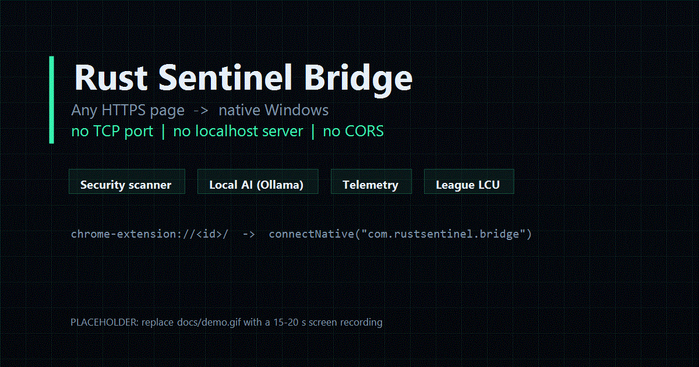

# Rust Sentinel Bridge

[English](README.md) · **Español**

[](https://github.com/sovith3/rust-sentinel-bridge/actions/workflows/ci.yml)
[](https://github.com/sovith3/rust-sentinel-bridge/releases/latest)
[](LICENSE)

**Conecta cualquier web HTTPS con Ollama local, telemetría de Windows, escaneo de archivos
o el cliente de League of Legends sin abrir puertos TCP, sin servidores locales y sin
errores de CORS.**



**[Demo en vivo](https://sovith3.github.io/rust-sentinel-bridge/)** ·
**[Última release](https://github.com/sovith3/rust-sentinel-bridge/releases/latest)** ·
**[Protocolo](docs/PROTOCOL.md)** ·
**[README completo (inglés)](README.md)**

`rust-sentinel-bridge.exe` es un binario Rust de ~1,5 MB que Chrome o Edge lanzan mediante
**Native Messaging**: stdin/stdout con un prefijo de longitud de 4 bytes. El canal solo
existe mientras el navegador mantiene el puerto abierto, está vinculado a un único id de
extensión y no escucha en la red, así que una página puede llegar a APIs nativas de Windows
que `fetch()` nunca podría tocar.

## ¿Por qué usar esto en lugar de un servidor en localhost?

| | Servidor HTTP en localhost | Rust Sentinel Bridge |
| --- | --- | --- |
| Superficie de red | Un puerto TCP que cualquier proceso local puede escanear y llamar | **Ningún socket**: stdin/stdout propiedad del navegador |
| CORS / preflight | Cabeceras permisivas, un proxy o trucos con `no-cors` | **No aplica**: ninguna petición HTTP sale de la página |
| Páginas HTTPS | El contenido mixto bloquea las llamadas a `http://` | **Permitido**: native messaging no es tráfico de red |
| Quién puede llamarlo | Cualquier página o aplicación que adivine el puerto | **Solo el id de extensión fijado** (`allowed_origins`) |
| Consumo en reposo | Un demonio, un puerto, logs y una entrada de autoarranque | **0 % CPU / 0 MB**: se lanza bajo demanda y muere con el canal |
| Distribución | El usuario instala y confía en un servidor | Un `.exe` y una extensión sin empaquetar, sin permisos de administrador |

## Inicio rápido

### Opción A — Instalar una release (no necesitas Rust)

1. Descarga `rust-sentinel-extension.zip` de la
   [última release](https://github.com/sovith3/rust-sentinel-bridge/releases/latest),
   descomprímela, abre `chrome://extensions`, activa **Modo de desarrollador**, pulsa
   **Cargar descomprimida** y selecciona la carpeta. Copia el id de 32 caracteres.
2. Descarga `rust-sentinel-bridge-win64.zip`, descomprímelo y ejecuta:

   ```powershell
   powershell -ExecutionPolicy Bypass -File .\install.ps1
   ```

   Pega el id cuando lo pida. El script copia el binario a
   `%LOCALAPPDATA%\RustSentinelBridge`, escribe el manifiesto, guarda `extension_id.txt` y
   registra el host en `HKCU` para Chrome, Edge, Brave, Vivaldi y Chromium. Sin permisos de
   administrador y sin tocar el `PATH`.
3. Recarga la extensión y abre la
   [demo en vivo](https://sovith3.github.io/rust-sentinel-bridge/). El indicador se pone
   verde cuando el host responde a un `PING`.

Desinstalar:

```powershell
powershell -ExecutionPolicy Bypass -File .\install.ps1 -Uninstall
```

### Opción B — Compilar desde el código fuente

Necesitas Rust estable y las build tools de MSVC (o el fallback GNU documentado en el
[README en inglés](README.md#option-b--build-from-source)).

```bash
git clone https://github.com/sovith3/rust-sentinel-bridge
cd rust-sentinel-bridge/native-host
cargo build --release --locked
```

Desde la raíz del repositorio, registra el host:

```powershell
powershell -ExecutionPolicy Bypass -File .\install.ps1
```

## Documentación

| Ruta | Qué contiene |
| --- | --- |
| [`README.md`](README.md) | Guía completa: adaptadores, seguridad, API desde la página y desarrollo. |
| [`docs/PROTOCOL.md`](docs/PROTOCOL.md) | Protocolo de tramas, acciones y payloads de cada adaptador. |
| [`web-demo/`](web-demo/index.html) | Demo estática que usa los cuatro adaptadores desde una página normal. |
| [`install.ps1`](install.ps1) | Instalador: copia el binario, escribe el manifiesto y registra las claves HKCU. |

## Licencia

Apache-2.0. Consulta [`LICENSE`](LICENSE) y [`NOTICE`](NOTICE).

Rust Sentinel Bridge es un proyecto independiente. No está afiliado, respaldado ni
patrocinado por Riot Games, Microsoft, Google, Brave u Ollama.
