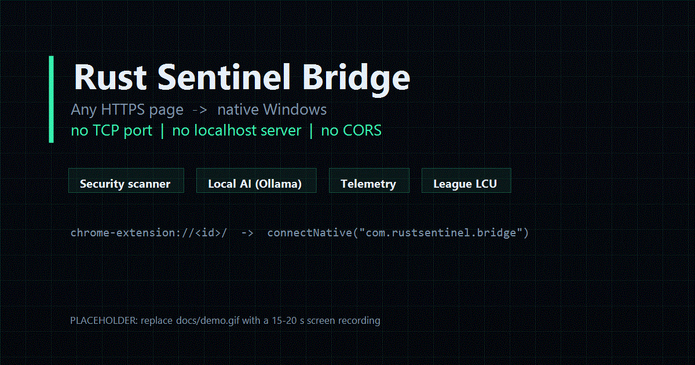

# Rust Sentinel Bridge

[](https://github.com/sovith3/rust-sentinel-bridge/actions/workflows/ci.yml)
[](https://github.com/sovith3/rust-sentinel-bridge/releases/latest)
[](LICENSE)
[](native-host/Cargo.toml)
[](#requirements)

**Connect any HTTPS page to local Ollama, Windows telemetry, file scanning or the League
client — without opening a TCP port, without a local server, and without CORS errors.**

<!-- Replace docs/demo.gif with a 15-20 s screen recording of the live demo (keep it under ~5 MB). -->


**[Live demo](https://sovith3.github.io/rust-sentinel-bridge/)** ·
**[Download latest release](https://github.com/sovith3/rust-sentinel-bridge/releases/latest)** ·
**[Wire protocol](docs/PROTOCOL.md)** ·
**[Español](README.es.md)**

`rust-sentinel-bridge.exe` is a 1.5 MB Rust binary that Chrome or Edge spawns through
**Native Messaging**: stdin/stdout framed with a 4-byte length prefix. The pipe only exists
while the browser holds it, it is pinned to one extension id, and nothing listens on the
network — so a web page can reach native Windows APIs that `fetch()` can never touch.

```
┌──────────────┐  postMessage   ┌──────────────┐  port   ┌────────────────┐
│  Web page    │ ─────────────► │ content.js   │ ──────► │ service worker │
│  (any origin)│ ◄───────────── │ (isolated)   │ ◄────── │  background.js │
└──────────────┘   to-page      └──────────────┘         └───────┬────────┘
                                                                 │ connectNative
                                                         4-byte LE framing
                                                                 ▼
                                              ┌──────────────────────────────┐
                                              │ rust-sentinel-bridge.exe     │
                                              │  security · ollama · sys · lcu│
                                              └──────────────────────────────┘
```

## Why not a localhost server?

The usual way to reach native code from a web page is `http://127.0.0.1:PORT`. It works,
but you pay for it in security and plumbing:

| | Localhost HTTP server | Rust Sentinel Bridge |
| --- | --- | --- |
| Network surface | A TCP port any local process can scan and call | **No socket at all** — stdin/stdout owned by the browser |
| CORS / preflight | Needs permissive headers, a proxy, or `no-cors` hacks | **Not applicable**: no HTTP request leaves the page |
| HTTPS pages | Mixed-content rules block `http://` calls | **Allowed**: native messaging is not network traffic |
| Who can call it | Any page or app that guesses the port | **Only the pinned extension id** (`allowed_origins`) |
| Idle cost | A daemon, a listening port, logs, an auto-start entry | **0% CPU / 0 MB** — spawned on demand, dies with the pipe |
| Distribution | Users install and trust a server | One `.exe` + one unpacked extension, no admin rights |

Because one `tokio` dispatcher multiplexes every request behind its id, telemetry and LLM
tokens stream back as `STREAM` frames while a slow file scan is still running.

## Quick start

### Option A — Install a release (no Rust needed)

1. **Extension** — download `rust-sentinel-extension.zip` from the
   [latest release](https://github.com/sovith3/rust-sentinel-bridge/releases/latest), extract
   it, open `chrome://extensions`, enable **Developer mode**, click **Load unpacked** and pick
   the extracted folder. Copy the 32-character id shown on the card.
2. **Native host** — download `rust-sentinel-bridge-win64.zip`, extract it, then:

   ```powershell
   powershell -ExecutionPolicy Bypass -File .\install.ps1
   ```

   Paste the extension id when prompted. The script copies the binary to
   `%LOCALAPPDATA%\RustSentinelBridge`, writes the native messaging manifest, saves
   `extension_id.txt`, and registers the host under `HKCU` for Chrome, Edge, Brave, Vivaldi
   and Chromium. No administrator rights and no `PATH` changes.
3. **Verify** — reload the extension and open the
   [live demo](https://sovith3.github.io/rust-sentinel-bridge/). The badge turns green when
   the Rust host answers a `PING`.

> Prefer the GUI? Running `rust-sentinel-bridge.exe` once without arguments does the same
> installation with a message box; it reads the id from
> `%LOCALAPPDATA%\RustSentinelBridge\extension_id.txt` or `RUST_SENTINEL_EXTENSION_ID`.

Uninstall at any time — `uninstall.ps1` ships in the same bundle and removes **any**
version of the bridge (current or older), every Chromium registration and the install
folder, without administrator rights:

```powershell
powershell -ExecutionPolicy Bypass -File .\uninstall.ps1
```

`-DryRun` prints what would be removed, `-KeepLog` saves `bridge.log` to your Desktop.
`install.ps1 -Uninstall` still works and forwards to `uninstall.ps1` when it is present.

### Option B — Build from source

Requires Rust stable plus the MSVC build tools (or the GNU fallback below).

```bash
git clone https://github.com/sovith3/rust-sentinel-bridge
cd rust-sentinel-bridge/native-host
cargo build --release --locked
```

Register it from the repository root — `install.ps1` finds the cargo output automatically:

```powershell
powershell -ExecutionPolicy Bypass -File .\install.ps1
```

* **MSVC toolchain** (default on Windows): nothing else is needed — the CRT is statically
  linked through `.cargo/config.toml`.
* **No MSVC linker?** Install the GNU toolchain plus a full MinGW-w64 distribution (GCC **and**
  binutils: `x86_64-w64-mingw32-gcc`, `as`, `dlltool`) and put its `bin` directory on
  `PATH`, then:

  ```bash
  rustup toolchain install stable-x86_64-pc-windows-gnu
  cargo +stable-x86_64-pc-windows-gnu build --release
  ```

  A bundled `dlltool` alone is not enough: it shells out to `as`, so a `dlltool` without
  binutils fails with `CreateProcess`.

## Contents

| Path | What it is |
| --- | --- |
| `native-host/` | Rust 2021 native messaging host (the `.exe`). Also installs itself into the registry. |
| `extension/` | Manifest V3 extension: service worker + content script + popup. |
| `web-demo/` | Single-file demo UI that drives all four adapters from a plain HTML page. |
| `docs/PROTOCOL.md` | Wire protocol, frame schema, every action and its payload. |
| `install.ps1` | One-shot installer: copies the host, writes the manifest, registers the HKCU keys. |
| `uninstall.ps1` | Version-agnostic uninstaller: stops the host, deletes every bridge registration and folder. |
| `.github/workflows/` | CI (fmt, clippy, build) and tag-driven release automation. |

## Adapters

| Adapter | Actions | What it does |
| --- | --- | --- |
| `core` | `PING`, `INFO` | Health check, adapter discovery, bridge metadata. |
| `security_scanner` | `SCAN_FILE`, `SCAN_DOWNLOADS_LATEST` | SHA-256, Shannon entropy, Authenticode via WinVerifyTrust, suspicious-API heuristics, 0-100 risk score. |
| `ollama_bridge` | `LIST_MODELS`, `CHAT_STREAM` | Streaming client for a **loopback-only** Ollama endpoint (`127.0.0.1`, `localhost`, `[::1]`). |
| `system_monitor` | `GET_SNAPSHOT`, `START_TELEMETRY`, `STOP_TELEMETRY` | CPU per core, memory, swap, disks, uptime, top CPU/RAM processes (sysinfo). |
| `lol_lcu` | `GET_STATUS`, `GET_CHAMP_SELECT`, `SUBSCRIBE_CHAMP_SELECT`, `STOP_SUBSCRIPTION` | Reads the Riot Client `lockfile`, authenticates with HTTP Basic, streams champion-select + gameflow events over `wss` with an HTTPS polling fallback. |

All adapters run inside one process behind a `tokio` dispatcher with per-request ids, so
streaming telemetry and a long LLM answer can be in flight at the same time.

## Requirements

| | |
| --- | --- |
| OS | Windows 10 or 11, x64 |
| Browser | Chrome, Edge, Brave, Vivaldi or Chromium 116+ |
| Rust host | Nothing to install — the release ships a statically linked `.exe` |
| Optional | [Ollama](https://ollama.com) on `127.0.0.1:11434` for the AI adapter |
| Optional | Riot Client running locally for the League LCU adapter |

## Manual installation (no script)

`install.ps1` is a convenience wrapper around three steps you can also do by hand.

**1. Binary + manifest.** Keep `rust-sentinel-bridge.exe` in a permanent folder (for example
`%LOCALAPPDATA%\RustSentinelBridge`) and create `com.rustsentinel.bridge.json` next to it:

```json
{
  "name": "com.rustsentinel.bridge",
  "description": "Rust Sentinel Bridge native messaging host",
  "path": "C:\\Users\\<you>\\AppData\\Local\\RustSentinelBridge\\rust-sentinel-bridge.exe",
  "type": "stdio",
  "allowed_origins": ["chrome-extension://<32-char-extension-id>/"]
}
```

**2. Registry.** Point the browser at that JSON (no administrator rights needed):

```powershell
$key = "HKCU:\Software\Google\Chrome\NativeMessagingHosts\com.rustsentinel.bridge"
New-Item -Path $key -Force | Out-Null
Set-ItemProperty -Path $key -Name "(Default)" `
  -Value "$env:LOCALAPPDATA\RustSentinelBridge\com.rustsentinel.bridge.json"
```

Repeat under `HKCU:\Software\Microsoft\Edge\NativeMessagingHosts\com.rustsentinel.bridge`
for Edge. The manifest pins `allowed_origins` to exactly one extension id, so any other
extension (or a web page) cannot spawn the host.

**3. Extension id.** Load `extension/` as an unpacked extension
(`chrome://extensions` → *Load unpacked*) and copy the id Chrome assigns. The host also
accepts `RUST_SENTINEL_EXTENSION_ID` or `%LOCALAPPDATA%\RustSentinelBridge\extension_id.txt`
when you run the `.exe` installer instead.

## Open the demo

Open `web-demo/index.html` from disk or use the hosted copy on
[GitHub Pages](https://sovith3.github.io/rust-sentinel-bridge/). The page states
**Bridge Connected** or **Extension Not Detected** and prints the next step under the badge.

The popup (`chrome://extensions` → *Rust Sentinel Bridge*) exposes the same actions plus an
auto-scan hook for finished downloads.

## Calling the bridge from a web page

The content script listens on `window.postMessage` under a private channel. Nothing is
injected into the page's JavaScript realm, so the site keeps its own globals intact.

```js
const CHANNEL = "rust-sentinel-bridge";

function call(adapter, action, payload = {}, onFrame) {
  const id = crypto.randomUUID();
  const listener = (event) => {
    const data = event.data;
    if (event.source !== window) return;
    if (!data || data.channel !== CHANNEL || data.direction !== "to-page") return;
    if (data.frame.id !== id) return;
    onFrame(data.frame);
    if (data.frame.event === "RESULT" || data.frame.event === "ERROR") {
      window.removeEventListener("message", listener);
    }
  };
  window.addEventListener("message", listener);
  window.postMessage(
    { channel: CHANNEL, direction: "to-extension", message: { id, adapter, action, payload } },
    "*"
  );
}

call(
  "security_scanner",
  "SCAN_FILE",
  { path: "C:\\Users\\me\\Downloads\\setup.exe" },
  (frame) => {
    if (frame.event === "STATUS") console.log(frame.data.message);
    if (frame.event === "RESULT") console.log(frame.data.riskLevel, frame.data.sha256);
    if (frame.event === "ERROR") console.error(frame.data.code, frame.data.message);
  }
);
```

Long-running work answers with `STREAM` frames before the final `RESULT`:

```js
call("ollama_bridge", "CHAT_STREAM",
  { endpoint: "http://127.0.0.1:11434", model: "llama3.1", prompt: "hi" },
  (frame) => { if (frame.event === "STREAM") process.stdout.write(frame.data.content); });
```

Frame schema, every action and every payload field are documented in
[`docs/PROTOCOL.md`](docs/PROTOCOL.md).

## Security model

* **No listening socket.** The host only exists while the browser holds the pipe.
* **Extension pinning.** The manifest's `allowed_origins` is a single validated id; any
  other extension (or a page) cannot spawn the host.
* **Explicit origin opt-in.** Only `https://*/*`, `http://localhost/*`,
  `http://127.0.0.1/*` and `file:///*` get the content script.
* **Ollama stays local.** `ollama_bridge` rejects any endpoint that is not loopback, so
  it can never be used as an open relay to the internet.
* **LCU credentials never leave the process.** The Riot `lockfile` password is read from
  disk, used for the HTTP Basic header, and never echoed in a response.
* **Bounded frames.** Requests and responses are capped at 8 MiB; oversize payloads are
  answered with an error frame instead of being truncated silently.
* **File access is caller-driven.** The scanner reads only absolute paths you send, or the
  newest file in `%USERPROFILE%\Downloads`.

The scanner is a **heuristic triage tool**, not an antivirus: it hashes, checks the
Authenticode chain, measures entropy and greps for injection-flavoured API names. It does
not replace Microsoft Defender.

## Development

```bash
cd native-host
cargo fmt --all -- --check
cargo clippy --all-targets --locked -- -D warnings
cargo build --release --locked
```

There is no build step for `extension/` or `web-demo/`: they are plain ES2022 + CSS.
`web-demo/index.html` is intentionally self-contained so it can be opened from disk.

Debugging tips:

* Installer output is appended to `%LOCALAPPDATA%\RustSentinelBridge\bridge.log`.
* `chrome://extensions` → *service worker* → console shows every frame the port receives.
* The demo page prints its own `console.info("[bridge] ping", …)` on every heartbeat.
* **Champion select shows nothing?** Open the *League LCU* tab of the demo: it subscribes
  automatically. The host retries every 3 s, so the log starts whenever the client is in
  champion select — no need to subscribe again after a browser or client restart. If your
  League install lives outside the usual paths, point the host at it with
  `RUST_SENTINEL_LCU_LOCKFILE=C:\path\to\lockfile`.
* Nothing at all in the log? Run `uninstall.ps1 -KeepLog`, reinstall, reproduce, and read
  the copied `bridge.log`.

## Contributing

Issues and pull requests are welcome. CI runs `cargo fmt --check`, `cargo clippy
--all-targets -- -D warnings`, the MSVC and GNU builds, and a syntax check of the extension
and demo scripts.

If this project saved you from writing a localhost server, a ⭐ helps other people find it.

## License

Apache-2.0. See [`LICENSE`](LICENSE) and [`NOTICE`](NOTICE).

Rust Sentinel Bridge is an independent project. It is not affiliated with, endorsed by,
or sponsored by Riot Games, Microsoft, Google, Brave or Ollama.
